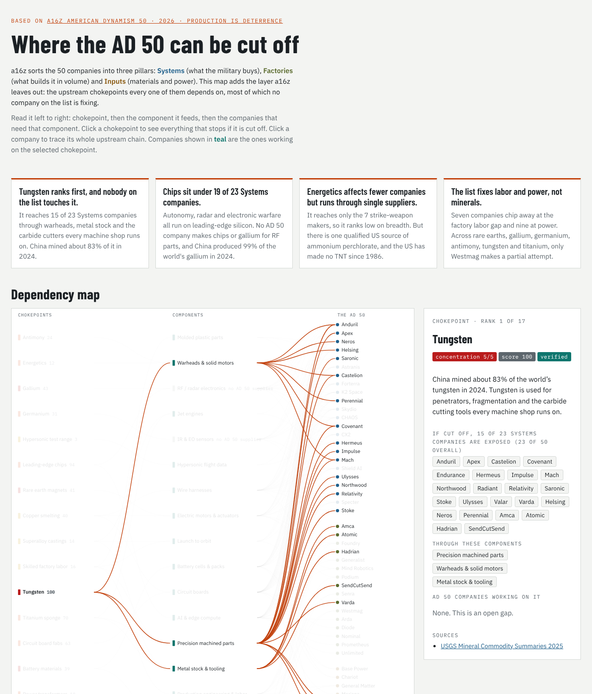

# AD 50 Chokepoint Map

**[Open the live interactive map](https://az9713.github.io/ad50-chokepoint-map/)**

[](https://az9713.github.io/ad50-chokepoint-map/)

An interactive supply chain map of the 50 companies in a16z's
[**AD 50 2026: Production is Deterrence**](https://www.a16z.news/p/ad-50-2026-production-is-deterrence)
(a16z American Dynamism, October 2026). It traces every company back to the upstream materials and capacity
it cannot ship without, then ranks those chokepoints.

## The source

a16z's annual American Dynamism 50 lists 50 companies "rebuilding and protecting America." The 2026 theme is
that deterrence depends on how much a country can *produce*, how fast, and for how long. The list is organized
into three pillars:

| Pillar | What it covers | Count |
|---|---|---|
| **Systems** | What the military buys: drones, missiles, satellites, rockets, radar, autonomous vessels | 23 |
| **Factories** | What builds those systems at volume: machining, wire harnesses, motors, robotics, manufacturing software | 16 |
| **Inputs** | The materials and power the factories run on: batteries, copper, lithium, uranium enrichment, reactors, grid power | 11 |

## What this project adds

The a16z post describes each company. It does not show how the companies depend on one another, or which
upstream chokepoints sit under all of them. This map adds that missing layer:

```
Chokepoints (17)  ──►  Components (17)  ──►  The AD 50 companies
tungsten, gallium,     motors, batteries,     Systems, Factories, Inputs
HALEU, transformers…   RF chips, warheads…
```

- Click a **chokepoint** to see which companies stall if it is cut off, and which AD 50 companies are working on it.
- Click a **company** to trace its full upstream chain, worst chokepoint first.
- The **bottleneck ranking** scores each chokepoint, and the **gaps** section lists chokepoints no company on the list addresses.

## Key findings

1. **Tungsten ranks first, and no company on the list works on it.** It reaches 15 of the 23 Systems companies through warheads, metal stock and carbide cutting tools. China mined about 83% of the world's supply in 2024 (USGS).
2. **Leading-edge chips sit under 19 of the 23 Systems companies.** None of the 50 makes chips, or the gallium that RF and radar parts need. China produced 99% of the world's gallium in 2024 (USGS).
3. **Energetics affects fewer companies but runs through single suppliers.** The US has one qualified producer of ammonium perchlorate and has made no TNT since 1986.
4. **The list fixes labor and power, not minerals.** Seven companies attack the factory labor gap and nine supply power. Across rare earths, gallium, germanium, antimony, tungsten and titanium, only Westmag makes a partial attempt.

## Scoring

```
score = concentration (1–5) × companies exposed ÷ (1 + AD 50 coverage)
```

The score is scaled so the top chokepoint equals 100. Coverage counts 1 for a company attacking a chokepoint
head-on and 0.5 for a partial attack. The score measures how *broadly* a chokepoint reaches across the list,
not how critical each component is. That is why energetics ranks low despite having single points of failure.

## Data and confidence

| File | Contents |
|---|---|
| [`data/companies.csv`](data/companies.csv) | 50 companies: pillar, location, founding year, components used and supplied, one-line summary |
| [`data/bottlenecks.csv`](data/bottlenecks.csv) | 17 chokepoints: rank, score, exposure, coverage, verified fact and source URLs |
| [`data/graph.json`](data/graph.json) | The full graph the page renders |

- **Stated:** pillars and supplier roles (for example Senra for wire harnesses, Westmag for motors) come from the a16z profiles. Anduril's solid rocket motor factory comes from [TechCrunch](https://techcrunch.com/2025/08/12/anduril-opens-solid-rocket-motor-factory-amidst-ongoing-chemical-chokepoint/).
- **Inferred:** which components each company uses is an engineering inference. a16z does not publish bills of materials.
- **Verified:** 13 of the 17 concentration figures are sourced from USGS Mineral Commodity Summaries 2025 and 2026, IPC, the Manufacturing Institute and Deloitte, Wood Mackenzie, NucNet, Oxford Economics, Breaking Defense, TechCrunch and AP. Each source is linked on the page.
- **Qualitative:** leading-edge chips, superalloy castings, solar polysilicon and hypersonic test capacity are scored by judgment, without a verified figure.

## Rebuild

The page is a single static `index.html` with no dependencies beyond Google Fonts.

```bash
python3 build/build.py   # regenerates data/graph.json, data/*.csv and index.html
```

To change a dependency or a score, edit the tables at the top of [`build/build.py`](build/build.py). The page's
markup, styles and script live in [`build/template/`](build/template/).

## Disclaimer

This is independent analysis, not affiliated with or endorsed by a16z or any company listed. Company summaries are
paraphrased; see the [original post](https://www.a16z.news/p/ad-50-2026-production-is-deterrence) for a16z's full
profiles. This is not investment advice.
